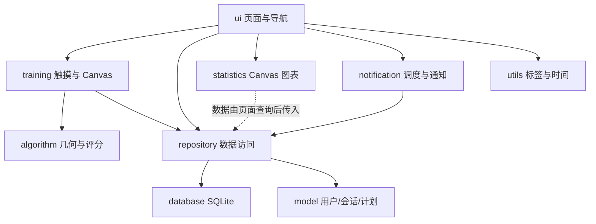
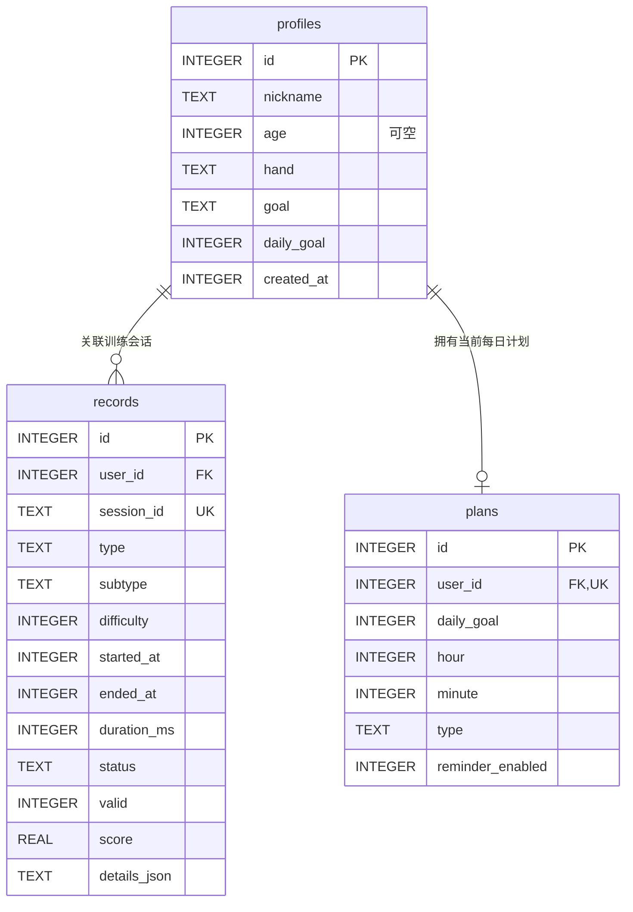

# 手部精细运动康复训练系统课程设计报告

项目名称：手部精细运动康复训练系统  
应用名称：指尖康复  
英文名称：Finger Rehabilitation Training  
技术路线：原生 Android / Java / XML / SQLite / Canvas  
当前版本：1.0.2（versionCode 3），本轮改动见 [版本记录](docs/CHANGELOG.md)

本文件面向本科《移动医疗开发》课程设计整理。内容描述已交付工程的设计、实现与验证方法；自动测试的实际结果以 [功能测试说明](docs/TESTING.md) 为准，未在真实手机或受试者身上执行的试验不表述为已完成实验。所有评分属于工程指标，不是临床诊断或疗效指标。

## 一、项目背景和意义

### 1.1 背景

手部精细动作涉及轨迹控制、目标定位、反应与连续操作等能力。智能手机触摸屏能够在不增加外接硬件的情况下，提供可交互的目标和轨迹，并记录触摸位置、时间、成功次数与错误次数。因此，设计一款本地运行的辅助训练软件，可以把课程中的移动界面、触摸事件、图形绘制、数据存储和分析技术结合起来。

本系统面向日常手指活动练习与课程演示场景，提供重复且可记录的任务。使用者可查看同一种任务下的表现变化，设置每日练习计划，而无需注册或连接服务器。

### 1.2 设计意义

软件从真实交互采集数据，将一次练习转化为可解释的工程指标，再将历史记录用于趋势展示和难度建议。与只展示静态页面相比，系统的价值在于完整实现“建档—选择任务—触摸训练—评分—持久化—分析—计划提醒”的流程。

本项目还用于练习以下工程能力：将计算逻辑与界面分离；使用数据库外键与唯一约束维护数据关系；区分缺失测量和数值 0；处理移动设备生命周期；根据系统权限与调度限制实现提醒；通过可复现算法测试验证边界条件。

### 1.3 应用边界

本项目不识别疾病，不给出医学诊断、康复处方或治疗效果结论。任务成绩不能直接解释为手功能临床量表。难度、阈值和权重由软件工程规则定义，未经临床人群校准。真实康复方案应由专业人员制定，练习出现疼痛或不适时应停止。

## 二、软件需求分析

### 2.1 目标用户与使用流程

系统服务于希望进行触屏手指练习的使用者，以及检查移动医疗课程工程实现的教师。用户第一次打开应用后创建昵称、惯用手、训练目标与每日次数；年龄选填，不要求身份证号或病历。完成训练后可立即查看结果，也可以从历史记录中查看相同报告。

正常操作流程为：

```text
首次引导 → 建立本地档案 → 首页
                         ├→ 训练模式与难度 → 真实触摸任务 → 保存结果 → 结果报告
                         ├→ 数据 → 历史筛选 / 成绩图表 / 删除确认
                         ├→ 计划 → 每日目标、时间、模式、提醒
                         └→ 我的 → 档案编辑 / 设置说明
```

### 2.2 功能需求

| 模块 | 主要需求 | 关键验收点 |
| --- | --- | --- |
| 用户信息 | 创建、查看、编辑、保存个人档案 | 重新打开应用后数据保留；会话关联用户 |
| 轨迹训练 | 直线、圆形、螺旋线，实时采样与绘制 | 完整性与偏差联合判定，不能随意画短线获得有效高分 |
| 反应训练 | 随机目标、规定轮数、命中/错误/超时 | 单调时钟；错误和超时分开；统计口径明确 |
| 协调训练 | 顺序点击和连续点击 | 错误不推进；一次触摸最多推进一次；节奏可计算 |
| 历史与分析 | 自动保存、筛选、详情、删除、四种图表 | 数据来自 SQLite；空状态真实；删除后同步刷新 |
| 个性化 | 三档可选难度与规则建议 | 根据同任务同难度有效历史推荐，由用户决定是否采纳 |
| 训练计划 | 每日次数、时间、模式、提醒和完成率 | 完成数来自真实有效记录；权限拒绝与重启可处理 |

### 2.3 数据与指标需求

每个会话保存唯一标识、用户、训练大类/子类、难度、起止日期、单调时长、状态、有效性、成绩、成功/错误/超时次数。按模式附加轨迹偏差、覆盖率、稳定性、反应时间和平均点击间隔。

不同类型的原始指标具有不同含义。系统不会把反应毫秒数和轨迹归一化距离混作同一个趋势。只对适用模式写入相应指标，不适用或未取得的测量使用 SQLite NULL。统计中的“0 次训练”和“暂无平均分”分别表达数量为零和没有有效成绩。

### 2.4 非功能需求

- **兼容性：** 最低 Android 8.0；坐标使用固定绘图区归一化，不依赖绝对像素评分。
- **可用性：** 浅色背景、蓝/青绿色、圆角卡片、清楚标题与较大触摸目标；主要导航位于底部。
- **可靠性：** 会话保存去重；训练完成或退出后清理回调；中断不假装完成；返回有确认。
- **隐私：** 无账号登录、无服务器、不申请无关权限；数据只保存在应用私有目录。
- **可维护性：** Java 17、内置 SQLite、原生 View，无运行时第三方库；算法可独立测试。
- **诚实性：** 不使用伪造训练数据填充首页、图表或难度建议，不把课程测试写成临床验证。

## 三、系统总体架构

### 3.1 技术选型

界面以 XML 提供基础页面布局，动态卡片与训练控件使用原生 View。训练区域和图表通过 Canvas 绘制，触摸使用 MotionEvent，Android 自带 SQLite 保存数据。提醒使用非精确 AlarmManager 和通知渠道，避免引入不必要的精确闹钟特殊权限。

工程使用 minSdk 26、compileSdk 36、targetSdk 35、AGP 8.13.2、Gradle 8.14.3、JDK 17。测试依赖 JUnit 与 Robolectric，不进入应用运行时依赖。

### 3.2 模块分工



`ui/` 负责页面和交互提示；`training/` 负责采样和训练状态；`algorithm/` 不依赖 Android UI，负责可复现计算；`repository/` 为数据访问入口；`database/` 管理表和版本；`statistics/` 只绘制传入的真实结果；`notification/` 负责计划调度与投递。

### 3.3 数据流与时间设计

一次训练生成一个会话标识。日期时间用于展示、按日统计和提醒；任务时长和反应时使用单调时钟，避免用户调整系统日期干扰测量。触摸采样进入训练模块，结束时交给算法，再将真实结果写入数据库，结果页依据记录 ID 从仓储读取数据。

首页与统计在返回时重新查询数据，各导航页保留滚动位置，训练难度和统计筛选持久保存。算法和图表没有生成随机成绩的逻辑；随机数仅用于反应目标位置与协调目标布局。

### 3.4 生命周期与异常设计

仅已开始训练的返回与重开保存中断记录，不增加有效完成数；未开始的浏览可直接离开，不生成记录或快照。切入后台时主动暂停并保存本地快照，返回后明确提示继续或结束，离开时段不计入用时。训练页在 Manifest 声明旋转配置变化，保留 Activity 和归一化采样；系统重建时尝试从私有文件快照恢复并处于暂停状态。快照入口按档案持久化；冷启动后再次进入训练页，可恢复上次任务、保存中断后开始本次所选任务，或保留数据并返回，避免覆盖尚未保存的训练。已完成待保存的会话恢复时保留完成状态和原成绩，可完成保存或保存结果后开始本次，不改成中断记录。训练结束采用一次性状态保护与会话唯一约束，关闭计时/动画回调。会话绑定原档案，防止恢复后串写；保存失败保留原动作，重试成功继续执行重开、退出或报告。暂停/旋转时清理旧手势，恢复后不接纳暂停前的历史事件；一次性选择和会话身份校验阻止双击与陈旧回调操作新会话。

Android 进程随时可能被系统回收。工程采用会话状态和保存策略减少丢失风险，但不能将尚未持久化的内存采样解释为绝对不会丢失；相关行为应在真机生命周期验收中检查。

## 四、主要功能模块

### 4.1 用户档案与首页

档案记录昵称、可选年龄、惯用手、训练目标、每日次数与创建时间。当前档案 ID 单独保存，训练记录与计划通过外键关联用户。输入在页面校验；有未保存修改时离开可保存、放弃或继续编辑，草稿、原档案与校验基线跨旋转保留。保存成功后重新进入应用仍可读取。

首页显示当前日期、欢迎信息、今日完成次数、最近成绩、快捷训练入口和近期记录。统计查询只使用当前档案，不使用演示成绩。没有记录时提供训练入口与明确说明。

### 4.2 轨迹描绘训练

目标包括直线、顺时针圆和由内向外螺旋。目标与实际描绘使用不同颜色，并提示起终点。训练 View 处理按下、移动、抬起与取消，采集归一化坐标、单调时间和笔画间断。页面显示计时与进度，支持重开和主动结束。

评分同时使用准确度、覆盖率、稳定性和时间。完整前台活动会话达到总时限时结束为未完成，不能在会话已超时后凭较短的首尾采样跨度取得有效成绩。文本指标按 50 ms 刷新，采样继续实时处理。有效性条件检查采样数量、起终点、路径长度、覆盖、顺序、断笔与时限，防止只在目标局部快速涂画取得高分。训练结束保存结果和相应的实际过程数据。为控制体积，采样最小间隔为 2 ms，达到 16,000 点后对真实样本进行保留首尾/断笔的压缩；评分与回放使用保留样本，明细记录观察和丢弃/压缩数量。

### 4.3 反应速度训练

目标圆随机出现在有效区域内，按难度改变半径、轮数与单轮时限。命中后本轮结束并生成下一目标；错误点击增加错误数但保留当前目标；超时单独记录并推进轮次。用户看到轮次、计时与命中反馈。

平均与最快反应时间只使用成功轮。准确率使用成功次数除以实际成功和错误点击总数，超时不混入点击分母。所有轮超时仍可显示真实超时数量，但不会生成有效训练成绩。

### 4.4 协调性训练

顺序模式将数字目标分布在训练区域，只有命中当前数字才能推进，点错仍保留当前目标。连续模式要求在指定圆形区域完成若干次点击，区域外点击不能推进。一次单指按下最多记为一次点击，最小间隔防止一次事件或极端高频输入重复计数。

结果显示总时长、正确与错误次数、准确率，以及有足够样本时的平均间隔和节奏稳定性。规定数量与时限共同约束有效完成。点击事件还设有 4,096 条保护上限，异常输入达到上限后结束为未完成、综合分为 0，保留已采集事件和保护标记。

### 4.5 结果、历史与可视化

结果页统一显示训练名称、难度、时间、成绩、准确率和错误，并根据模式补充指标。非有限或超范围旧分数显示“—”；可读明细中的全部事件每组 30 条翻页，单条损坏不妨碍其余事件，未知时间不冒充 0。轨迹坏点形成断笔，避免虚构运动。反馈只解释工程表现，不推断病情。

历史按开始时间倒序，以摘要每页 30 条 SQL 分页展示，点击进入报告时才分块读取明细；返回与旋转保留页码和滚动，删除只出现一个确认框。统计可按训练大类、具体任务和难度筛选。图表包括历史成绩折线、三类有效均分比较、近 7 天会话次数与近 30 天日均有效成绩；仅在同一任务、同一难度下连接成绩趋势，混合范围提供汇总说明。图表绘制轴、刻度、标签与数据点，支持点选读值、方向键切换及无障碍前后项/读值动作；缺失日不假装有成绩，数据不足时显示说明。

### 4.6 个性化难度

三档参数集中在算法配置，界面明确显示用户选择。提高难度会缩小允许偏差和点击目标、缩短时限、增加轮次/目标数量或螺旋复杂度。

推荐由仓储先限定同一任务子类型，再根据最近 5 次同难度、有效已完成记录计算均分。≥85 分建议提高一级，<60 分建议降低一级，其余保持；样本不足不下结论。推荐只提示，不自动改变训练参数。

### 4.7 计划与提醒

当前档案可维护一份每日计划，包括目标次数、本地时间、训练大类与提醒开关。有未保存修改时返回可保存、放弃或继续编辑，草稿与对话框状态跨旋转保留。今日完成数从数据库按本地日界限查询，只包含匹配模式的有效已完成记录。完成率用于展示目标进度，不把中断任务计为完成。

提醒由单次非精确 AlarmManager 触发，再安排下一本地日历日。关闭、删除或修改计划先取消旧任务；代次与参数校验拒绝过期广播，已投递日期避免同一天重复通知。同一计划再次打开应用保留现有闹钟，避免取消已到时间但等待系统投递的提醒；重启、更新、时钟/时区变化后强制重新安排。计划写入与调度失败分别提示，不把保存失败显示为成功。

Android 13 及以上按需请求通知权限；拒绝权限时保留训练和计划功能，并显示状态。提醒受系统省电策略影响，不能保证精确到设定分钟；强停后的行为遵循 Android 系统限制。

## 五、数据库设计

### 5.1 概念结构



实体 `UserProfile`、`TrainingRecord`、`TrainingPlan` 对应物理表 `profiles`、`records`、`plans`。完整字段字典见 [README 数据库结构](README.md#数据库结构)。

### 5.2 训练指标与缺失值

`records` 统一保存任务身份和公共计数，附加可空的 `accuracy`、`average_reaction_ms`、`fastest_reaction_ms`、`mean_deviation`、`coverage`、`stability`、`average_interval_ms`。模式明细保存在 `details_json`，避免把一个训练类型的原始字段混作另一个类型。

比例以 0～1 保存，界面格式化为百分比；偏差以绘图区边长为单位，时间以毫秒保存。无适用指标保留 NULL，展示为“—”。统一有效完成须满足有效标记、completed 状态及有限的 0～100 分；旧坏分不计入成绩、推荐和计划完成数，其历史、次数和时长保留。

### 5.3 一致性与查询

外键在数据库配置时启用，档案删除可级联删除所属会话与计划。记录的 `session_id UNIQUE` 约束与保存前查询使重复完成回调幂等。历史、详情、删除、统计、推荐和写入均限定当前档案；仓储拒绝跨档案写入、非有限指标及越界比例。摘要查询不加载轨迹 JSON，并提供任务/难度筛选与稳定排序分页。单条报告先取摘要，再按每块 64Ki Unicode 字符读取明细；超过 4Mi 字符或不可读时仅返回摘要和提示，不改写原库，schema 仍为 3。

索引 `records_user_time(user_id, started_at DESC, id DESC)` 支持历史倒序，`records_user_type_time(user_id, type, started_at DESC)` 支持筛选；版本 3 增加 `records_user_task_time(user_id,type,subtype,difficulty,started_at DESC,id DESC)` 支持具体任务与难度查询。计划的 `user_id UNIQUE` 保证每档案一份当前计划。

### 5.4 版本升级

当前数据库版本为 3。版本 1 升至 2 时检测现有字段，以 `ALTER TABLE ... ADD COLUMN ... REAL` 增加可空指标；版本 2 升至 3 只新增任务/难度复合索引，也支持版本 1 直接升级至 3。升级不删除已有表或用 0 填充从未测量过的指标。后续新增结构需继续编写明确迁移与测试。

## 六、关键算法

完整实现见 `algorithm/TrainingAlgorithms.java`、`Geometry.java` 和 `DifficultyRecommender.java`；详细公式及边界见 [docs/ALGORITHMS.md](docs/ALGORITHMS.md)。

### 6.1 坐标与几何

训练绘图区为固定正方形，原点为绘图区左上角，坐标除以正方形边长。目标参数和用户路径因此处于同一尺度；不能按用户路径自身的包围盒拉伸，否则短线会被错误拉伸为完整轨迹。

实际路径与目标均按累计弧长重采样为 128 点。点到线段距离采用投影系数截断到 [0,1] 后的欧氏距离；点到折线路径距离取各线段最小值。断笔间不添加虚构连线，重复静止点不增加长度。

### 6.2 轨迹指标与综合分

设容差为 `τ`，实际采样为 `P_i`，目标采样为 `Q_j`：

```text
D = mean_i distance(P_i, 目标折线)
Do = mean_i ||P_i − Q_i||
C = count_j(distance(Q_j, 实际折线) ≤ τ) / 128
A = 0.75 × clamp(1 − D/(2τ)) + 0.25 × clamp(1 − Do/(4τ))
```

空间稳定性取实际与目标二阶位置差的平均残差 `R`：

```text
Ss = 1 / (1 + R/(0.5τ))
St = 1 / (1 + 速度标准差/平均速度)
S = clamp(0.65Ss + 0.35St)
理想时长 = max(1800, 目标路径长度 × (4200 − 500 × 难度)) 毫秒
T = min(1, 理想时长/首尾采样间描绘时长)
Score = 100 × (0.40A + 0.30C + 0.20S + 0.10T)
```

会话总训练用时包含开始后首次触摸前的等待，轨迹算法的描绘时长取首尾采样时间差，均扣除明确暂停；无论首尾采样跨度如何，完整活动会话达到任务总时限即判为未完成。

有效性要求：完成状态明确、有限数值与单调时间合法、点数不少于 8、时长为 500 ms 至任务时限、实际/目标长度比 0.65～2.2、覆盖率 ≥0.70、起终点误差 ≤2τ、断笔无大幅跳跃、`D≤2.5τ` 且 `Do≤4τ`。不满足时保留可测指标，综合分为 0，标记为无效或未完成，不进入有效成绩统计。

### 6.3 反应统计与评分

训练界面采用 `SystemClock.uptimeMillis()` 与 MotionEvent 同源的单调时间，扣除明确暂停时段，再乘以 1,000,000 转为算法纳秒输入：`r_i=(响应时刻−目标出现时刻)/1,000,000` 毫秒。平均为成功轮反应的算术平均，最快为最小值，无成功轮时二者为空。

```text
A = 成功次数 / (成功次数 + 错误点击次数)
V = clamp(1 − (平均反应毫秒 − 80)/(单轮时限 − 80))
C = 成功次数 / 规定轮数
Score = 100 × (0.45A + 0.35V + 0.20C)
```

超时单独计数，不属于点击准确率分母。有效性要求完成轮数一致、至少一次成功、响应顺序合法、无重复轮次、成功反应不早于 80 ms 且不超过单轮时限。

### 6.4 协调性与节奏

对有效点击时间差求平均 `μ` 和总体标准差 `σ`，稳定性 `S=1/(1+σ/μ)`。没有有效间隔时结果为空。准确率仍以正确/(正确+错误)计算。理想单次时间随任务与难度变化：顺序模式为 1600/1350/1100 ms，连续模式为 750/600/450 ms。

```text
T = min(1, 规定数量 × 理想单次时间 / 实际时长)
Score = 100 × (0.45A + 0.30T + 0.25S)
```

仅达到规定数量、时间有效且未超时、有效点击间隔不少于 50 ms 的完成任务为有效。未完成、空输入、倒序时间与异常高频输入不产生有效成绩。

### 6.5 难度推荐

仓储先过滤具体任务子类型，再由算法过滤训练类型、当前难度、有效且已完成的记录，按结束时间降序取最近 5 次。计算均分后：≥85 且尚未最高难度则建议提高一级；<60 且尚未最低难度则建议降低一级；其余保持。样本不足 5 条时仅显示实际样本量并说明不足。

### 6.6 边界处理

算法限制分数在 0～100，比例在 0～1，对空集合、非有限坐标、零长度、无成功点击、负时间差与零间隔采用显式检查，避免除零和 NaN。单调时钟用于测量，墙钟只用于日期。界面保存缺测语义，不能用一个默认 0 冒充各模式都进行了同样测量。

## 七、系统测试

### 7.1 测试策略

测试分为纯 Java 算法测试、Robolectric 下的数据库与 Android 组件测试，以及真实设备人工验收。算法用确定输入复现输出；数据库用临时测试数据验证增删改查、用户隔离、NULL、防重复与升级；真实手机检查触摸、视觉、系统权限、返回/旋转/后台与提醒投递。

### 7.2 重点用例

- 轨迹：理想路径、偏移路径、局部路径、逆序、断笔、空输入、极少点数、比例缩放与时间异常。
- 评分：0～100 边界、无有效点击、0 时间、超过时限与未完成状态。
- 反应：单调时差、成功均值/最小值、错误/超时口径、过快反应与重复轮次。
- 协调：有序推进、点击防重复、最小间隔、均值与节奏稳定性。
- 推荐：不足 5 条、85/60 边界、不同任务与难度隔离、最低和最高难度限制。
- 数据：档案/计划持久化、记录插入查询删除、相同会话不重复、缺测 NULL、无记录统计与旧版本迁移。
- 提醒：本地下一日计算、开关与修改、过期广播、同日去重、权限与渠道关闭、重启恢复。

### 7.3 执行方法与实际结果

在 JDK 17 与 Android SDK 36 环境执行：

```bash
./gradlew --no-daemon testDebugUnitTest assembleDebug lintDebug
```

1.0.2 统一命令输出 `BUILD SUCCESSFUL in 31s`，16 类共 166 项测试全部通过，0 失败/错误/跳过；Lint 为 0 errors/25 warnings，APK 清单及签名复核通过。分类计数、保留警告和设备验证范围见 [docs/TESTING.md](docs/TESTING.md)。HTML 报告位于 `app/build/reports/`，Debug APK 位于 `app/build/outputs/apk/debug/app-debug.apk`。

1.0.2 最终 APK 已在 API 26 软件模拟器升级，保留 RehabQA 与旧直线记录。实际 UI 验证未开始训练返回不新增记录、档案草稿继续/放弃、计划修改的继续/放弃/保存返回；再以 12 次 ADB 触摸完成简单连续点击，产生有效 76.6 分记录，不适用指标为 NULL。强停重开后原昵称、两条有效记录及 all/5 次/提醒关闭计划保留，首页为 2/5、40%；独立证据见测试文档。软件模拟器/ADB 开销不能代表人类操作或手机性能；其余任务、通知及重启投递没有完成全面设备验收。

真实手机验收按该文档的流程执行，涵盖用户提出的 17 项验收标准。尚未完成的真机项目标记为待执行；本工程未进行临床受试者试验，不报告虚构样本量、康复改善率或医疗统计显著性。

### 7.4 覆盖边界

JVM/Robolectric 可以验证计算与部分框架行为；新增原生 Skia 离屏渲染测试能生成实际 Android View 的预览并检查窄屏长指标，包含以自动构造 MotionEvent 完成螺旋训练后从持久化记录加载的结果页；仍不能完全复现触摸硬件、真实设备 GPU、厂商后台管理、Doze 或重启后的通知行为。上述原生 Skia 图片是离屏输出；实际模拟器截图另以 `emulator-*.png` 命名。构建成功证明编译链完整，不等于全部设备体验已通过。需要在 Android 8.0 与 Android 13 及以上设备补充实测，并保存 Logcat、截图与实际观察。

## 八、项目总结

本项目建立了一个无服务器的原生 Android 辅助训练系统，实现档案管理、三类触摸训练、对应工程评分、本地记录、真实统计图表、难度推荐与每日计划提醒。设计将真实采样、算法计算和持久化结果联系起来，避免以静态界面、固定成绩或假数据代替功能。

工程中的主要处理包括固定尺度归一化、轨迹完整性门槛、单调反应测量、适用指标 NULL、会话唯一约束、用户查询范围和非精确提醒恢复。分层结构使后续修改评分和界面不必集中改动一个 Activity，也方便课程展示算法测试与数据库设计。

本版本仍需完成真实设备的全流程与厂商提醒适配验证，且没有临床有效性结论。数据仅本地保存，没有云备份、导出与跨设备同步；当前计划为单一每日重复计划；仓储已有分页与摘要读取，历史数据量扩大后仍需评估归档与后台分析。后续可以在专业指导下评估可用性和任务参数，在明确隐私与研究方案后再考虑更严格的测量可靠性研究，但不得直接把游戏成绩当作医学诊断依据。
